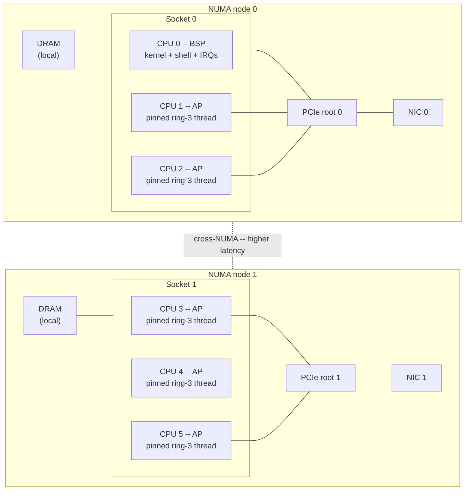

<p align="center">
  
</p>

# Isurus - Zero-Interrupt NUMA Cluster

A bare-metal research kernel for x86-64. Its direction is to run a cluster of machines as one NUMA computer: remote machines become NUMA nodes, with their cores and memory at higher latency, one process runs threads on cores of several machines, and its threads exchange data through explicitly shared memory regions while their working memory stays local.

An asymmetric kernel: one control core runs the kernel and services, the other cores are compute cores that each run one pinned application thread with direct device access; the cluster target extends this to a NUMA-aware single system image.

> **Status (single node only).** Today the kernel boots from a BIOS ISO and is tested in QEMU Q35. CPU 0 runs the kernel, all interrupts and a cooperative ring-3 shell; every other core runs one pinned ring-3 thread. ACPI NUMA topology discovery, PCIe enumeration and a virtio-net driver work.
>
> **Not yet implemented:** multi-node clustering, cross-node shared memory (DSM), DPDK-style NIC access (application threads reach the NIC through a syscall passthrough today), SPDK-style storage access. No latency or jitter comparison with Linux exists yet.
>
> Details: [What works today](#what-works-today), [Roadmap](#roadmap).

## Why "Isurus"

*Isurus* is the genus of the mako shark. Mako sharks are obligate ram ventilators: they must keep swimming to breathe. They never stop, they never sleep, they never idle. They have warm-blooded muscles in an otherwise cold-blooded lineage -- specialized engineering for sustained high performance. They are the fastest sharks in the ocean, solitary pelagic hunters.

The metaphor maps directly to the kernel's design: threads never yield, CPUs never throttle, cores run at full speed continuously, each thread owns its hardware and hunts alone. Stop moving and you die.

## The problem

Scaling a workload beyond one machine today means rewriting it as a distributed system:

- **Linux + MPI:** explicit message passing. You serialize, send, deserialize. Your algorithm disappears under communication boilerplate.
- **Kubernetes / microservices:** network boundaries everywhere. Every cross-node interaction is an RPC with serialization overhead and failure modes.
- **RDMA (InfiniBand):** gives you remote memory reads, but not remote execution. You still manage two separate address spaces and coordinate manually.
- **Historical DSM (Treadmarks, Ivy):** bolted on top of a general-purpose OS. Context switches, syscall overhead, full networking stack in the data path. They proved the concept but couldn't deliver the performance.

The common thread: the OS gets in the way.

## Target design

The design Isurus is built towards. For what is implemented, see [What works today](#what-works-today).

- **Cluster as NUMA topology.** Each remote machine adds NUMA nodes, each with its own cores and memory, at a higher latency. One process runs threads on cores of several machines, as it would on several NUMA nodes of one machine. Same abstraction, different latency numbers.
- **One thread per core, pinned.** No scheduling, no migration, no context switching. Placement is decided once at creation.
- **One address space, explicit locality.** A process has one address space across all nodes. A thread's private memory (stack, working set, device mappings) is always on its local NUMA node and visible only to that thread. Threads exchange data through a shared region, mapped at the same virtual address in every thread. At start, each thread receives a locality map that tells, for every shared slice, whether it is on the same NUMA node, the same machine or a remote machine. A remote page of the shared region is fetched on demand: the access faults, and the BSP fetches the page from its owning node over a layer-2 link and maps it read-only ([architecture](docs/developer/architecture.md)).
- **Single-writer coherence.** Each shared memory slice has exactly one writer, permanently. Ownership never transfers. No write contention by design.
- **Direct device access.** NICs and storage controllers are mapped into userspace. Threads poll devices directly (DPDK-style for NICs, SPDK planned for storage). No syscalls for I/O.
- **No dynamic power management.** P-states locked to max frequency, no deep C-states (C1/HLT is the floor), T-states ignored. Cool your hardware appropriately.

This is not a general-purpose OS. Not Linux. Not for running Docker containers, web servers, or desktop applications. There is no POSIX and no dynamic linking.

## Hardware model



Each socket sits between its local DRAM and its local PCIe root.
The PCIe root is the gateway between the cores and external devices;
the NIC sits one hop past the root, on the device side. Every core
in a socket reads and writes its local DRAM and drives the local
NIC through the local PCIe root. The dashed link between sockets is
the only path to cross-NUMA memory or to a remote socket's NIC, and
it pays the higher latency.

**CPU 0 (the BSP) is the only core that runs the kernel, the shell,
and handles interrupts -- it is also the only core that ever sees a
syscall.** Every other core is an AP: exactly one pinned ring-3
thread for its lifetime, no scheduling, no migration, no context
switching, no kernel-mode work in the data path. Placement is the
only scheduling decision.

A single process spans multiple cores -- one thread per AP -- and
in the planned cluster mode spans cores across multiple machines. Each
thread reaches its memory and its NIC on its own locality: local
DRAM through the on-die memory controller, local NIC through the
local PCIe root. No cross-NUMA hop, no network round-trip, no
syscall, no scheduler latency between the thread and the hardware
it owns. That is the floor on which everything else is built.

(Two sockets and three cores per socket above is illustrative; the
model scales to N sockets and N cores per socket.) See
[docs/research/overview.md section 7](docs/research/overview.md)
for the execution model and
[docs/developer/architecture.md](docs/developer/architecture.md)
for the implementation.

## Design doctrine

The kernel is meant to be **as small and basic as possible**, retaining maximum performance and minimum latency, yet with a very optimized design for the targeted tasks. Performance comes first. The second principle, applied wherever it costs no data-path performance, is: **eliminate categories of bug by construction rather than detect them at runtime.**

Kernel bugs compound silently -- a bit-flip deep in the kernel may sit dormant for years until a layout shift brings it to a live code path. Runtime checks (asserts, sanitizers, watchdogs) only help on the build that caused the damage, not on the build where it finally fires. So Isurus accepts several up-front tradeoffs -- static sizing, one-thread-per-core, no context switching on APs, single-writer shared memory, per-thread address spaces, polled I/O only, placement as the only scheduling decision -- and in exchange excludes whole classes of bug (data-path allocator corruption, AP data races, lock contention, cache-coherence races, interrupt-timing Heisenbugs, scheduler non-determinism). You pay by sizing your working set ahead of time; you gain a system that is correct by construction within its envelope.

See [Research Overview, section 2](docs/research/overview.md) for the full doctrine and what each design choice removes.

**Single node (target):** a low-jitter, ultra-low-latency execution environment. One thread per core, no interrupts on application cores, CPUs at max frequency, direct device polling. Use cases: high-frequency trading, packet processing, real-time sensor ingestion, any workload where deterministic per-core execution matters.

**Cluster (target):** heavy parallelism across dedicated hardware. A single process spans multiple machines, threads exchange data through explicitly shared regions, each thread owns its core and its NIC. Use cases: large-scale graph processing, distributed in-memory databases, shared aggregation across hundreds of cores.

## What works today

- ISO-first BIOS boot flow (El Torito no-emulation boot via xorriso)
- Boots on x86-64 QEMU Q35. Real hardware is the target: every change is checked for QEMU-specific behaviour and for what real Intel/AMD machines do differently, and a first bare-metal boot is planned ([Roadmap](#roadmap), milestone 4).
- SMP: AP bringup via INIT-SIPI-SIPI
- ACPI: MADT, SRAT, SLIT, HPET, FADT, MCFG, DMAR/IVRS parsing with query APIs
- PCI device enumeration (PCIe ECAM via MCFG)
- Virtio-net driver and NIC abstraction layer
- Ring 3 shell on BSP with SYSCALL/SYSRET and cooperative multitasking
- FAT32 read-only filesystem, IDE driver
- kmalloc/kfree with bitmap allocator (4KB granularity)
- Per-CPU structures, per-CPU TSS
- 80x28 text mode VGA driver

## Quick start

```bash
scripts/compile_qemu.sh
```

## Documentation

- **[Getting Started](docs/getting-started/building.md)** -- build toolchain, compile scripts, QEMU setup
- **[Research Overview](docs/research/overview.md)** -- motivation, core concepts, evaluation goals
- **[Application Model](docs/user/application-model.md)** -- execution model, memory model, how to write applications for Isurus
- **[Architecture](docs/developer/architecture.md)** -- kernel design decisions and rationale
- **[Full Documentation Index](docs/README.md)** -- all documentation organized by audience

## Roadmap

Milestones from the current single-node kernel to a first multi-node run. The first multi-node run is on bare metal; the hardware is not chosen yet. These are plans, not features. Full task list: [docs/project/todo.md](docs/project/todo.md).

1. **Memory isolation on one node.** Supervisor-only kernel mappings, SMEP/SMAP and NX where the CPU supports them, one page table (CR3) per AP with private, shared and kernel zones ([architecture](docs/developer/architecture.md), "Thread memory isolation"), guard pages below stacks. No protection that adds cost on the AP data path: KPTI is not used. Until then all cores of an application share one address space.
2. **AP kernel surface.** Syscalls not allowed on APs are refused, AP console output goes through a per-core ring drained by the BSP, user pointers are checked.
3. **AP bringup and NIC queues.** Calibrated IPI delays, x2APIC for APIC IDs above 254, a trampoline page chosen from E820; one NIC queue pair per core instead of one shared queue per node.
4. **Bare metal.** First boot on real hardware with the serial log recorded, and one driver for a real NIC, polled from ring 3 through mapped MMIO.
5. **Single-node measurements.** Jitter, packet latency and memory locality measured against Linux tuned for the same workload, on the same machine, with raw data and scripts published. The P-state and C-state policy is implemented first.
6. **Cluster design, before any cluster code.** Written consistency model, how write detection and remote invalidation fit the zero-interrupt rule, failure semantics (coordinator, partitions, replication granularity).
7. **Cross-node shared memory.** Shared regions and the locality map on one node, a layer-2 link between nodes driven by the BSP, remote shared pages fetched on demand with single-writer coherence and invalidation.
8. **First multi-node demonstration.** Two bare-metal nodes, read-mostly single-writer shared slices, one workload (shared aggregation or a connection table). The latency of each stage of a remote fetch is measured and the workload is compared with a message-passing or sharded baseline. Results are published whether they are positive or negative.

Not yet placed in this order: the test harness rework, the BSP coordinator for threads spanning cores, the placement solver, page replication and failover, cross-node time synchronization (PTP), the DPDK-style NIC library beyond one driver, the SPDK-style storage library.

## Research questions

Isurus tests two separate hypotheses. Neither has been demonstrated.

### 1. AI-assisted development changes the cost of building a specialised OS

General-purpose operating systems dominate partly because an operating system is a very large amount of work. Specialised kernels existed long before AI coding tools (unikernels, exokernels, lightweight HPC kernels) and stayed niche, partly because of the supporting work around the core design: drivers, firmware tables, tests, documentation. Kernel work is also slow to debug: triple faults, early boot failures and little observability.

The hypothesis: an engineer who defines the architecture and the specifications, and who directs and checks AI-generated work, can build and maintain a specialised kernel that would otherwise need a larger team. AI is used to speed up implementation, tests, diagnosis and supporting work; design, specifications and technical judgement stay with the engineer. Isurus is the experiment that tests whether this is practical for one engineer.

### 2. A purpose-built OS can outperform a tuned general-purpose OS for one workload

A general-purpose OS pays for its generality with complexity and compromises. If building an OS becomes cheaper, single-purpose systems designed around one workload become practical. The question is whether such a system performs better than a general-purpose OS configured for the same workload. This is an untested hypothesis, not a result.

**Low-latency / HFT experiment.** The concrete test is a low-latency workload (high-frequency trading): can Isurus give lower latency and less jitter than Linux tuned for the same purpose, with CPU isolation, thread pinning and low-latency kernel and system configuration? The baseline is tuned Linux, not a default installation. This experiment is not implemented or measured yet.

### Multi-node direction

Separate from both hypotheses: a zero-interrupt, NUMA-first design across machines (see [Target design](#target-design)). Each thread keeps its working memory on its local node; threads of the same process on different nodes exchange data through the shared region; the locality map tells which addresses are remote. Remote memory does not replace local working memory. This is a research direction; its performance and practicality are not demonstrated.

### How the work is done

- The author designed the core architecture: the BSP/AP split, zero-interrupt polled APs at maximum frequency, the NUMA-first cluster model, explicit single-writer cross-node shared memory and static sizing. For implementation-level decisions the AI agent investigates and proposes options with trade-offs, and the author chooses. Decisions are recorded with their date and the options not taken (example: [docs/project/todo.md](docs/project/todo.md), app slot load address).
- Before 2026, all code was written by the author. Since 2026, most code, tests, PR descriptions and documentation are written by an AI agent (Claude Code), under the project rules in [CLAUDE.md](CLAUDE.md): every plan states what relies on QEMU behaviour and what real hardware does differently, performance claims need measured data, and unclear requirements are asked about, not assumed.
- Each change is a pull request that states the problem, the measured evidence, the change, the tests and what is not verified. The author reviews every pull request and merges it.
- CI builds the kernel and boots it headless in QEMU on every pull request, with serial and network tests ([test/run_tests.sh](test/run_tests.sh)). Repository hooks require the devbox toolchain, a CHANGELOG entry for every code change, and ASCII-only text.
- QEMU is the development and test environment. Real hardware is the target. No real-hardware boot log is in the repository yet.

## History

- **2012-2014: OS fundamentals.** Isurus started in 2012 as a hobby OS, to learn how a computer works below the OS abstraction: 64-bit initialisation, paging, interrupts. The first Git commit is from June 2013 ([15f4f1c](https://github.com/pierreact/Isurus/commit/15f4f1c481b8195311b9261f6904881bbe27aa8c)); 31 commits up to October 2014.
- **2014-2026: dormant.** No commits from October 2014 to February 2026.
- **2026-present: research OS.** Revived in February 2026 to investigate whether a purpose-built OS can give lower latency and less jitter than tuned Linux for HFT workloads, a zero-interrupt NUMA-first architecture, explicit shared memory across nodes with local working memory, and whether AI-assisted, specification-driven development makes this practical for one engineer (see [Research questions](#research-questions)). Development ran from February to April 2026 and resumed in November 2026. AI-assisted development started with the revival; the AI tool configuration (`CLAUDE.md`, Claude Code hooks) was kept out of the repository until 2026-11-20.

## License

Apache License 2.0 with one permanent condition: production use by or on behalf of a high-frequency trading business requires a commercial license from the author. Every other use, including other commercial production use, is permitted under Apache 2.0. Because of this condition, Isurus is source-available, not open source. The exact terms and definitions are in [LICENSE](LICENSE). Commercial licenses: pierreact at gmail dot com.

Outside code contributions are not accepted at this time. Issues and discussion are welcome.

## Contact

Pierre Ancelot -- pierreact at gmail dot com
